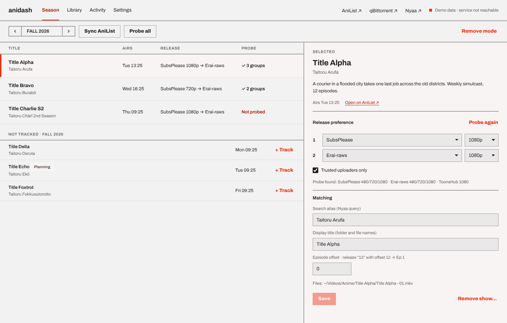

# anidash

anidash follows your AniList **Watching** list. When a new episode airs, it finds the release you prefer on Nyaa, downloads it with its built-in BitTorrent engine (or your qBittorrent, if you prefer), saves it as `<Library>/<Title>/<Title> - 05.mkv`, updates your AniList progress and moves the file to the Trash after 30 days. Watch with VLC, from the dashboard or however you like.

It runs on **Linux** (any desktop; headless works too) and **Windows 10/11**. Everything stays on your computer: the dashboard is served on `127.0.0.1` only.



## Install

### Windows
Download `anidash-x.y.z-setup.exe` from [Releases](https://github.com/rafaefarrukh/anidash/releases) and run it. No admin rights are needed, and nothing else is required; VLC is recommended for playback.

### Arch / EndeavourOS / Manjaro
```bash
paru -S anidash          # or yay -S anidash
```

### Any Linux (pipx)
The window uses your distro's WebKitGTK, so install that first, then anidash with pipx:

| Distro | System packages |
|---|---|
| Arch | `sudo pacman -S python-gobject webkit2gtk-4.1 libayatana-appindicator python-pipx` |
| Debian / Ubuntu / Mint | `sudo apt install python3-gi gir1.2-webkit2-4.1 gir1.2-ayatanaappindicator3-0.1 pipx` |
| Fedora | `sudo dnf install python3-gobject webkit2gtk4.1 libayatana-appindicator-gtk3 pipx` |

```bash
pipx install --system-site-packages anidash
anidash
```
The first launch adds anidash to your app menu. No WebKitGTK? `pipx install "anidash[qt]"` uses Qt instead, and if neither is available the dashboard opens in your browser.

## First run

anidash opens a three-step setup:

1. **AniList.** Press *Connect AniList*, approve anidash in the window that opens, and you're done. The token lasts a year; Settings warns you two weeks before it expires.
2. **Downloads.** *Built-in (recommended)* needs nothing: anidash downloads with its own BitTorrent engine (libtorrent, with DHT, peer exchange and encryption). Already run qBittorrent? Choose *Use my qBittorrent*: quit qBittorrent, then press *Configure automatically*. anidash turns on qBittorrent's Web UI for this computer only, with a private random login, keeps a backup of qBittorrent's settings, and starts it again. Already use the Web UI (Sonarr, a phone app…)? Choose *I already have a Web UI login* instead, so your existing login keeps working. You can switch later in Settings → Downloads.
   - Optional, either way: bind downloads to your VPN interface. That's the kill switch: if the VPN drops, transfers stop instead of using your real IP, and they resume when it's back. Keep the rest of the computer off the VPN if you can, because Nyaa blocks many VPN exit IPs.
3. **Library.** Pick the folder. Tick *Start at login* to keep anidash in the tray.

Finishing imports the shows on your AniList Watching list.

## Use

- **Season:** browse a season and **Track** shows (this sets them to Watching on AniList). For each show, press **Probe Nyaa** to see which groups and resolutions exist, pick preference 1 and 2, then **Save**. Nothing downloads for a show until it has a preference.
- **Library:** *Today* lists the last 24 hours. **Play** opens the newest episode. Each episode shows how many days are left before it goes to the Trash.
- **Activity:** downloads in progress, the scheduled jobs (with **Run now**) and the log.
- **Remove a show:** turn on *Remove mode*, press ✕, then choose an AniList status and score. AniList is updated first, and if that fails nothing is deleted.
- **Tray icon:** open the dashboard, check for episodes now, pause automation, quit. Closing the window leaves anidash running in the tray.

## How it decides

- Only preference 1 for the first 24 h after airing, then preference 2 as well. After 7 days with nothing found, the episode is marked failed; **Retry** restarts the clock.
- A release is accepted only if it's a single `.mkv`/`.mp4` of 50 MB–3 GB, from a trusted uploader when *Trusted only* is on, and its episode number (after the offset) matches.
- If a v2 appears within 3 days, it replaces v1 (v1 goes to the Trash) and the 30-day clock restarts.
- **Tracking mid-season:** episodes up to your AniList progress are never downloaded. Aired episodes after it are fetched once (turn this off in Settings → *Already-aired episodes*).
- Nothing is deleted outright: purge and removal use the Trash / Recycle Bin, and only inside the library folder.
- No seeding: a finished torrent is stopped at once and removed as soon as its file is in place.
- File names are Windows-safe on every OS (`Re:Zero` → `ReZero`, `Title: Sub` → `Title - Sub`), so a library on a partition shared between Linux and Windows works from both.

## Where things are

| | Linux | Windows |
|---|---|---|
| Database (settings, shows, episodes, log) | `~/.local/share/anidash/` | `%LOCALAPPDATA%\anidash\` |
| Logs | `~/.local/state/anidash/log/` | `%LOCALAPPDATA%\anidash\Logs\` |
| Secrets (AniList token; qBittorrent password if you use it) | system keyring (GNOME Keyring / KWallet) | Windows Credential Manager |
| Library (default) | `~/Videos/Anime` | `Videos\Anime` |

With no keyring at all (headless servers), secrets go to a private file in the config folder, and Settings says so.

## Command line

```bash
anidash                    # open the dashboard (starts it in the tray if needed)
anidash status             # running? where are its files?
anidash quit [--wait]
anidash forget --yes       # delete saved logins and the window profile (the uninstaller's "remove my settings")
anidash autostart on|off
anidash service --no-tray  # run without a tray (servers)
anidash install-systemd    # headless Linux: a systemd user unit; then `loginctl enable-linger $USER`
```

On a headless machine, open `http://127.0.0.1:8787` through an SSH tunnel (`ssh -L 8787:127.0.0.1:8787 server`).

## Upgrading from v1

v2 imports v1's database and settings on first start (Linux). **Stop the v1 service first**. anidash refuses to download while v1 is still running, to avoid fetching everything twice:

```bash
systemctl --user disable --now anidash.service anidash-kick.timer
rm ~/.config/systemd/user/anidash{,-kick}.{service,timer} ~/.local/share/applications/anidash.desktop
rm -r ~/.local/share/anime-dl/app ~/.local/share/anime-dl/venv   # the old code; your data was copied
```

## Troubleshooting

- **No tray icon on GNOME:** install the *AppIndicator and KStatusNotifierItem Support* extension. anidash still runs without it; open it from the app menu.
- **"Nyaa unreachable" / 429 in the log:** your ISP blocks Nyaa, or you're on a VPN exit IP. Set a mirror in Settings → *Nyaa base URL*.
- **qBittorrent "banned 127.0.0.1":** too many failed logins. Restart qBittorrent, then fix the login in Settings.
- **Keyring errors right after login:** your wallet unlocked late. anidash retries on the next job.

## Security

- Listens on `127.0.0.1` only and checks the `Host` header against DNS rebinding.
- Every API call that changes something needs a per-start random token (injected into the dashboard page, and in `runtime.json` with mode 600 for the CLI) and a same-origin request.
- VLC, qBittorrent and the Trash are called with argument lists, never a shell. Downloaded files are never executed; only `.mkv`/`.mp4` are accepted.
- The qBittorrent Web UI is configured for `127.0.0.1` with localhost authentication **on**.

## Development

```bash
git clone https://github.com/rafaefarrukh/anidash && cd anidash
python -m venv --system-site-packages .venv && . .venv/bin/activate
pip install -e ".[dev]"
pytest -q                       # includes an offline libtorrent download; the qBittorrent test runs when qbittorrent-nox is installed
anidash service --no-tray       # then open http://127.0.0.1:8787
```
The dashboard is `src/anidash/web/Dashboard.dc.html`. Opened as a plain file (no service), it shows demo data.

Windows build: `python packaging/windows/make_version.py && pyinstaller packaging/windows/anidash.spec`, download the WebView2 bootstrapper to `packaging/windows/MicrosoftEdgeWebview2Setup.exe` (https://go.microsoft.com/fwlink/p/?LinkId=2124703), then `iscc packaging\windows\anidash.iss`. CI builds and tests the installer on every push.

## License

MIT. Bundles React (MIT) and the Archivo font (SIL OFL 1.1).
